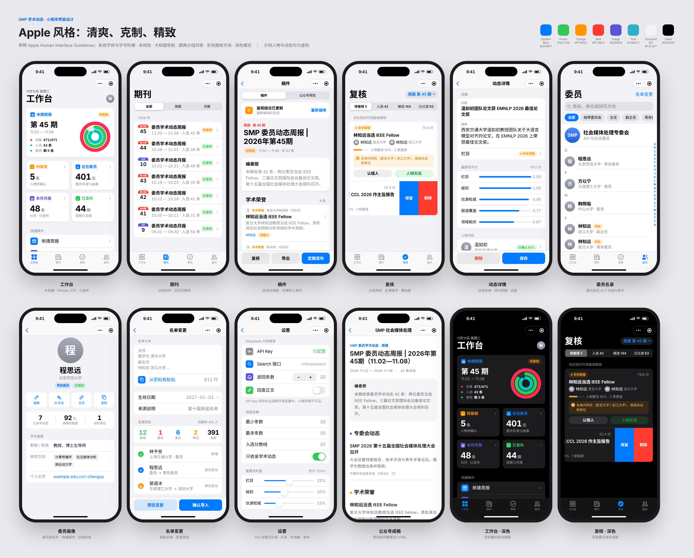

# SMP 委员学术动态 · 微信小程序（云开发）

中国中文信息学会社会媒体处理专委会（SMP）公众号**委员学术动态周报 / 月报**的生产工具，采用微信小程序 + 微信云开发架构：

- **数据采集**：DeepSeek 开放搜索（Search API），可选 Fetch API 回查正文；
- **数据分析**：清洗、委员人物去歧义、学术相关性过滤、三层去重、重要性打分、选出 30~50 条；
- **数据成稿**：DeepSeek 改写（带事实校验），输出公众号排版稿（内联样式 HTML）与 Markdown；
- **名单与画像**：委员名单支持换届和调整（自动比对增删改），每位委员有画像档案与动态时间线。

> 只收录学术相关动态：学术活动、学术荣誉/获奖、学术成果、科研项目、学术任职与服务、学术影响力。



## 架构

```
┌──────────── 微信小程序（miniprogram/） ────────────┐        ┌──────────── 云开发 ────────────────────────────────┐
│ 工作台 · 期刊 · 稿件 · 复核 · 动态详情             │ call   │ 云函数 smp（action 路由 + 权限校验）                 │
│ 委员名录 · 委员画像 · 名单变更 · 系统设置          │──────▶ │  ├ service/api.js       页面读写接口                  │
│ 统一入口 utils/api.js → wx.cloud.callFunction      │        │  ├ service/pipeline.js  任务队列采集 → 分析 → 成稿 → 发布│
└────────────────────────────────────────────────────┘        │  ├ lib/*                纯逻辑（可单测）              │
                                                              │  └ 定时触发器（每分钟）推进队列、按计划建刊、清理缓存   │
                                                              │ 云数据库 14 个集合（database/schema.md）              │
                                                              │ 云存储 exports/*.html（导出公众号稿）                 │
                                                              └──────────────┬───────────────────────────────────────┘
                                                                             │ HTTPS（Key 仅在云函数环境变量）
                                                                             ▼
                                                              DeepSeek：/v1/tools/search · /v1/tools/fetch · /chat/completions
```

**为什么用任务队列**：一期周报约 470 次检索，单次云函数执行时长有限。所以每个查询是 `tasks` 集合里的一条任务：

- 定时触发器每分钟推进一次；工作台页面打开时，前端也会持续推进，加快进度。
- 每批任务在时间预算内完成。任务用条件更新领取，防止重复处理；超时的任务会被自动回收。
- 采集时就**增量完成**清洗、消歧和学术过滤，只把命中委员的学术条目落库。所以最后的汇总分析只处理几百条，在一次调用内就能完成。
- 搜索和 LLM 响应写入 `cache` 集合，重跑不会重复计费。

## 目录

```
miniprogram/                 小程序前端
  app.json / app.wxss        全局配置与设计规范（Design Tokens）
  utils/api.js format.js     云函数调用封装、展示常量
  theme.json                 浅色/深色主题变量（导航栏、标签栏）
  components/                cat-tag · status-pill · empty-state · icon-tile（彩色图标方块）· activity-rings（三环）
  pages/                     home · issues · issue · review · event · members · member · roster · settings
  images/                    tabBar 与功能图标（由 design/icons.js 生成）
cloudfunctions/smp/          云函数（唯一后端入口）
  index.js                   action 路由、角色校验、定时触发入口
  config.json                超时 60s、每分钟定时触发器
  service/                   store（数据库访问/缓存）· pipeline（流水线）· api（页面接口）
  lib/                       text · roster · profiles · deepseek · collect · disambiguate · classify · dedup · rank · analyze · compose
  data/                      默认配置、单位别名、2026-11-10 官网名单（初始化时导入 401 人）
database/                    schema.md（集合与字段）· indexes.json（索引）· security-rules.json（权限）· setup-cloud.js（一键建表/权限/索引）· build-seed.js + seed/（控制台导入数据）
design/                      页面风格图（Apple 风格，含深色）：overview.png、screens/*.png、mockups.html；生成脚本 mockups.js / render.js / icons.js
tests/                       Node 单元测试 + 云函数端到端测试（内存模拟云数据库与 DeepSeek）
legacy/python-cli/           上一版 Python 命令行实现（算法参考，保留可运行）
```

## 部署步骤

1. 用微信开发者工具打开仓库根目录，把 `project.config.json` 的 `appid` 改成你的小程序 AppID（不能用 `touristappid`），然后开通云开发。
   - 把 `miniprogram/config.js` 的 `envId` 改成该 AppID 下的云环境 ID。
   - 在文件树中右键 `cloudfunctions` 目录 →“当前环境”，选择同一个环境。
2. **云函数**：右键 `cloudfunctions/smp` →“上传并部署：云端安装依赖”。
   - 在函数配置里设置环境变量 `DEEPSEEK_API_KEY`，超时时间 60 秒。
   - 右键 `config.json` →“上传触发器”。
3. **数据库**：按下面任选一种方式初始化。
4. 编译运行小程序。首位进入的用户点“开始使用”成为管理员。其他编辑在工作台复制自己的 OpenID，由管理员在“设置 → 成员与权限”中添加。

### 常见问题：云环境 ID 对不上

| 现象 | 原因与处理 |
|---|---|
| 上传云函数时提示环境不存在或不匹配 | `cloudfunctions` 目录没有选环境：右键 `cloudfunctions` →“当前环境” → 选择你的环境 ID |
| 环境列表里没有你的环境 | 环境不属于当前 AppID：检查“详情 → 基本信息”的 AppID，与创建环境时所用的 AppID 一致；云开发控制台要从本项目工具栏的“云开发”按钮进入 |
| 小程序调用报 `env check invalid` / `-501000` | `miniprogram/config.js` 的 `envId` 与实际环境不一致 |
| 提示“游客模式不支持云开发” | `project.config.json` 的 `appid` 仍是 `touristappid` |

## 数据库快速初始化

| 内容 | 方式一：云函数自动（推荐） | 方式二：本地脚本 | 方式三：控制台导入 |
|---|---|---|---|
| 14 个集合 | ✅ 自动创建 | ✅ | 手动新建 |
| 默认配置 + 401 位委员 | ✅ 自动导入 | —（随后小程序初始化完成） | 导入 `database/seed/*.json` |
| 集合权限 | 默认“仅创建者可读写”（客户端读不到云函数写入的数据） | ✅ 设为“仅管理端可读写” | 手动设置 |
| 25 个索引 | — | ✅ 按 `indexes.json` 创建 | 手动创建 |

**方式一：云函数自动初始化**（零配置，部署完云函数即可）
- **自动触发**：小程序首次打开或点“开始使用”时，云函数发现集合不存在会自动建表，并写入默认配置、导入名单。
- **手动触发**：也可以在开发者工具中右键云函数 `smp` →“云端测试”（或在云开发控制台的云函数测试里）输入下面的事件。尚无管理员时可以直接执行；之后只有管理员可用。各步都是幂等的，可以重复执行。

```json
{ "action": "admin.setupDb" }
```

**方式二：本地脚本一次配好权限和索引**（推荐与方式一配合使用）
- 用到腾讯云 CloudBase 管理 API `@cloudbase/manager-node`。
- 需要腾讯云“访问管理 → API 密钥”中的 SecretId / SecretKey，并且对该环境有管理权限。密钥只通过环境变量传入。

```bash
cd database && npm install
```

```bash
node setup-cloud.js --dry-run
```

```bash
SMP_ENV_ID=<云开发环境ID> TENCENTCLOUD_SECRETID=<SecretId> TENCENTCLOUD_SECRETKEY=<SecretKey> node setup-cloud.js
```

> 若权限接口调用失败（该接口在 SDK 中已标记为旧接口），脚本会提示改到控制台设置：集合 → 权限设置 →“仅管理端可读写”，或自定义规则 `{"read": false, "write": false}`。

**方式三：控制台手动导入**
- 运行下面的命令，生成 `database/seed/members.json`（401 条）和 `config.json`。

```bash
node database/build-seed.js
```

- 在云开发控制台 → 数据库中新建对应集合 → 导入 → 选择文件，冲突处理选 Upsert。
- 索引按 `database/indexes.json` 在“索引管理”中添加。

### DeepSeek 接口（已按官方文档核对，2026-11-10）

依据 [Search & Fetch 指南](https://api-docs.deepseek.com/guides/search) 与 [Chat API](https://api-docs.deepseek.com/api/create-chat-completion)：

| 接口 | 用法 |
|---|---|
| `POST /v1/tools/search` | 请求 `query`（1~128 字）、`count`（1~50，本系统用 20）、`need_content: true`、`ori_question`（本系统填“某某（单位）近期的学术活动、学术获奖与学术成果”，帮助理解查询意图）。<br>查询词末尾自动加操作符 `after:<周期起-容差> before:<周期止+1天> lang:zh,en`，在**检索时**就限定时间窗口；总长超出 128 字时截断基础查询部分。<br>返回顶层 `results`，每条含 `title / url / snippet / summary`（600~800 字长摘要，正文缺失时用于消歧）`/ content / site_name / date / authority`（-1~4）`/ rerank_score`（0~3） |
| `POST /v1/tools/fetch` | 请求 `{url}`，返回 `{title, content}`（Markdown）；可选的正文回查 |
| `POST /chat/completions` | 模型 `deepseek-flash`（旧名 `deepseek-chat` 已不在可选列表）。消歧裁决、改写、画像补全都是结构化任务，因此传 `thinking: {type: "disabled"}` 并使用 `response_format: json_object` |

结果利用方式：
- `rerank_score` 低于 0.3 的结果直接丢弃（阈值可配置）。
- 不在配置表里的域名，信源权威度用 `authority / 4` 折算。

错误处理按文档执行：
- 408、429、5xx 指数退避重试；
- 402（余额不足）、401（Key 无效）时任务退回队列，不计失败，并停止本轮；
- 其他 4xx 不重试。

**费用估算**（按文档价格，只计成功请求）：
- Search / Fetch 都是每 1000 次 $0.75，限速分别为 100 / 25 QPS（账户级）。
- 一期周报约 470 次检索，约合 **$0.35**；重跑命中缓存，不再计费。
- LLM 改写与裁决使用 `deepseek-flash`，按 token 计费，每期费用很低。

## 每期工作流

| 步骤 | 页面 | 说明 |
|---|---|---|
| 建刊 | 工作台 → 新建周报/月报（或定时自动：周一 8:00 周报、每月 1 日 9:00 月报） | 周报约 470 次检索。月报复用当月周报数据，只补充检索核心委员 |
| 采集 | 工作台封面卡显示进度 | 完成后自动分析、成稿，进入“待复核” |
| 复核 | 复核 → 待复核 / 入选 / 候选 / 已过滤 | 保留、剔除、认错人、人物无误。结论写入 `overrides`，**对今后各期长期生效** |
| 改稿 | 动态详情 | 修改标题、摘要、栏目；查看评分拆解、人物识别证据和信源 |
| 编排 | 稿件 → 重新编排 | 应用复核结论后重新去重、打分、选稿，手工改过的标题会保留 |
| 导出 | 稿件 → 导出 | 公众号 HTML 上传到云存储，复制下载链接，在电脑上打开后全选粘贴到公众号编辑器；也可以复制 Markdown |
| 发布 | 稿件 → 定稿发布 | 写入 `archive`，用于跨期去重，并出现在委员画像的时间线中 |

## 核心算法（`cloudfunctions/smp/lib/`）

- **人物消歧** `disambiguate.js`
  - 长名优先：“张伟男”不会被识别成“张伟”。两字名做右边界校验：“王博士”不算王博。
  - 证据打分：本人单位（含别名和历史单位）邻近 +0.35、学术语境、研究方向关键词、可信域名、查询来源、专委会语境为正证据；同名者特征词 −0.35、紧邻其他单位、常见姓名为负证据。
  - 名单内同名的三组（王博、李倩、刘洋）按证据择优，分不开的进入复核。
  - 介于两个阈值之间的交给 DeepSeek 裁决；人工结论优先级最高。
- **学术过滤与分类** `classify.js`：学术信号词不少于非学术信号词才保留，标题强信号优先（例如“论文获最佳论文奖”归入荣誉）。级别识别：院士、Fellow、国家奖、最佳论文为 1.0。
- **去重** `dedup.js`：
  1. 文档级：URL 规范化、正文 3-gram Jaccard、标题相似度。
  2. 事件级：同一委员 + 同一栏目 + 7 天内 + 标题相似或命中同一荣誉词。
  3. 跨期：与同类刊期近 90 天的已发布内容比对。
- **打分与选稿** `rank.js`：
  - 打分：`100 × Σ 权重·(栏目, 级别, 身份, 信源权威, 覆盖度, 领域相关, 时效) × (0.6+0.4·置信度) × 跨期降权 + 专委会加分`。
  - 选稿：贪心选取 30~50 条，同一委员逐条衰减并设上限，各栏目有占比上限；条数不足时逐步放宽分数线。
- **成稿** `compose.js`：LLM 改写后做事实校验。缺少委员姓名、出现原文没有的数字或长度异常时，回退为原文摘句。

## 设计规范（Apple 风格）

界面参照 Apple Human Interface Guidelines：清爽、克制、精致，并支持深色模式。完整规范见 `miniprogram/app.wxss`，风格图见 `design/`。

| 要素 | 规范 |
|---|---|
| 颜色 | iOS 系统色：systemBlue `#007AFF` 为主色，Green / Orange / Red / Indigo / Teal 作语义色；文字与背景用 label / secondaryLabel / separator / systemGroupedBackground `#F2F2F7` 等语义色，深色模式自动切换 |
| 字体 | 系统字体（iOS 上为 SF Pro + 苹方），字号阶梯同 iOS Dynamic Type：Large Title 34pt、Headline 17pt、Body 17pt、Footnote 13pt 等（1pt = 2rpx）；数字使用圆体等宽数字 |
| 导航 | 一级页面用大标题导航（自定义导航栏），二级页面用标准导航栏；底部为半透明毛玻璃工具栏 |
| 列表 | 圆角分组列表（Inset Grouped，圆角 10pt），分隔线从文字处开始缩进，配“设置”风格的彩色图标方块和右侧箭头 |
| 组件 | 分段控件、iOS 开关（绿色）、步进器、滑块、通讯录首字头像、A–Z 索引条；复核列表左滑操作，使用官方 WeUI 扩展库 `mp-slideview`（`app.json → useExtendedLib`，无需 npm，不占包体积） |
| 数据可视化 | 工作台用 Fitness 风格同心三环（canvas 2d 绘制、圆头端点），分别表示采集进度、入选数、复核完成度 |
| 图标 | 原创线性图标（`design/icon-paths.js`），统一线宽、圆角端点；标签栏选中时为实心 |
| 深色模式 | `app.json → darkmode` + `theme.json` 适配导航栏和标签栏；WXSS 通过 `prefers-color-scheme` 切换语义色 |

重新生成风格图和图标：

```bash
npm run mockups
```

```bash
node design/icons.js
```

## 测试

```bash
npm test
```

测试分两部分：

- **单元测试**：名单解析（401 人、三组同名）、名单增删改同步、拼音英文名（含复姓、多音姓），以及消歧（同名按单位判定、边界、长名优先、同名演员、英文名、人工覆盖）、学术过滤、分类、30~50 条选取、事实校验、增量处理与汇总。
- **云函数端到端测试**：用内存模拟云数据库和 DeepSeek 接口，覆盖整条链路：
  - 权限与初始化：未授权用户被拒、首位用户成为管理员、导入名单；
  - 名单变更：预览与正式导入；
  - 采集与成稿：创建周报 → 队列采集 → 自动分析成稿（转载合并、同名者过滤、同名委员分别判归、改写事实校验）；
  - 复核与发布：复核与重新编排（手工标题保留）→ 导出 → 发布 → 画像时间线 → 重跑命中缓存 → 定时触发器。
